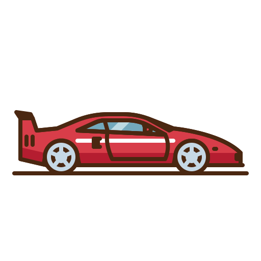

# CarSpotter

  

  <strong>L'applicazione definitiva per gli appassionati di car spotting.</strong> 
  Cattura, cataloga e scopri la rarità di ogni vettura avvistata per strada — 100% offline e local-first.

  
  
  
  
  

---

## 📖 Panoramica

**CarSpotter** trasforma la passione per le automobili in un'esperienza di collezionismo interattiva e gamificata, ispirata al concetto di "Pokédex" automobilistico. 

Ogni volta che incontri una supercar, una leggenda da rally, una classica d'epoca o una rarità stradale, puoi immortalarla, registrarne la posizione GPS esatta e scoprirne all'istante il **livello di rarità** calcolato da un algoritmo matematico dedicato basato sui dati reali di produzione, potenza, prezzo ed eredità storica.

Tutti i dati e le foto restano memorizzati **esclusivamente sul tuo dispositivo** grazie a un'architettura **local-first** veloce, resiliente e rispettosa della privacy.

---

## 📲 Download & Aggiornamento

CarSpotter non è (ancora) pubblicata sul Play Store: si installa direttamente tramite il file **APK** allegato a ogni release.

### Prima installazione

1. Vai nella sezione **[Releases](../../releases)** di questa repository.
2. Scarica l'ultimo file `.apk` dalla release più recente (sezione *Assets*).
3. Apri il file dal tuo cellulare (dalle notifiche di download o dall'app *File*).
4. Se richiesto, consenti al browser o al file manager di **installare app da fonti sconosciute**.
5. Conferma l'installazione e apri CarSpotter. 🚗

### ⚠️ "Questa app NON è dannosa"

Durante l'installazione Android (o Play Protect) potrebbe mostrare un avviso che segnala l'app come non verificata o potenzialmente dannosa. **È normale e non significa che l'app sia pericolosa.**

Succede perché l'app non viene distribuita tramite il Google Play Store: Android mostra questo avviso per qualsiasi APK scaricato fuori dallo store, dato che Google non ha potuto controllarlo né verificarne lo sviluppatore. Pubblicare sul Play Store richiede una registrazione a pagamento e un processo di revisione, che per un progetto personale e di passione come questo non è previsto.

Il codice sorgente è pubblico in questa repository, quindi puoi verificare di persona cosa fa l'app. Se l'avviso compare, scegli **"Installa comunque"** (o **"Maggiori dettagli" → "Installa comunque"**).

### 🔄 Aggiornare l'app

1. Controlla nella sezione **[Releases](../../releases)** se è disponibile una versione più recente di quella installata.
2. Scarica il nuovo `.apk`.
3. Installalo **sopra la versione esistente**, senza disinstallare nulla: i tuoi avvistamenti e le tue foto vengono mantenuti.

> 💡 **Consiglio:** prima di aggiornare, crea un **backup** dalla funzione di esportazione dell'app, così i tuoi dati sono al sicuro in ogni caso.

---

## 🔃 Mantieni il Catalogo Aggiornato

Il catalogo delle auto viene ampliato nel tempo con nuove marche e nuovi modelli. Per averlo sempre al passo, nelle **Impostazioni** dell'app trovi una sezione dedicata all'**aggiornamento del catalogo**.

**👉 Ti consigliamo di premere quel tasto ogni tanto** (e in particolare dopo ogni nuova release), così potrai avvistare e registrare anche le ultime vetture aggiunte.

1. Apri CarSpotter e vai nelle **Impostazioni**.
2. Cerca la sezione **Aggiorna catalogo**.
3. Premi il tasto di aggiornamento e attendi la conferma.

> 💡 Gli avvistamenti che hai già registrato non vengono toccati: l'aggiornamento aggiunge solo i nuovi modelli al catalogo.

---

## ✨ Funzionalità Principali

### 📸 Avvistamenti Dettagliati (Spotting)
- **Scatta o importa**: Fotografa al volo dalla fotocamera integrata o seleziona uno scatto dalla tua galleria.
- **Dettagli completi**: Assegna colore specifico, anno di produzione stimato, note personali e contrassegna veicoli da corsa (🏁 *Racing*) o speciali (*Preferiti*).
- **Geolocalizzazione GPS**: Tracciamento istantaneo delle coordinate geografiche dell'avvistamento con mappa interattiva integrata ([flutter_map](https://pub.dev/packages/flutter_map) / OpenStreetMap).

### 🏆 Algoritmo Dinamico di Rarità & Iconicità
Non tutte le auto sono uguali! Un algoritmo ponderato analizza le specifiche tecniche del veicolo:
- **5 Tier di Rarità**:
  - ⚪ **Common** (Auto di grande serie)
  - 🟢 **Uncommon** (Sportive accessibili / versioni speciali)
  - 🔵 **Rare** (Prestigiose o a tiratura ridotta)
  - 🟣 **Epic** (Supercar e serie limitate)
  - 🟡 **Legendary** (Hypercar ed edizioni ultra-esclusive)
- 🔥 **Status Icona**: Un badge esclusivo riservato ai modelli che hanno segnato la cultura pop, la storia del motorsport e il design automobilistico.

### 📚 Catalogo Precaricato (45+ Marche, 1000+ Modelli)
- Esplora un vasto database offline contenente oltre **1.000 modelli** di **46 marchi iconici** (Ferrari, Porsche, Lamborghini, Alfa Romeo, Lancia, BMW, Toyota e tanti altri).
- Monitora la tua percentuale di completamento per ciascun marchio.
- Motore di ricerca rapido per marca e modello con indicatore visivo delle vetture già avvistate.

### 🏎️ Il Tuo Garage Personale
- Galleria fotografica pulita ed elegante dei tuoi avvistamenti.
- **Filtri avanzati**: Filtra per marchio, vetture iconiche (🔥), vetture racing (🏁) o ordina per rarità crescente/decrescente.
- Schede dettaglio interattive con visualizzazione su mappa, statistiche e modifica in tempo reale.

### 📊 Dashboard & Statistiche
- Statistiche in tempo reale: totale avvistamenti, modelli unici registrati, numero di leggendarie e icone collezionate.
- Carosello automatico dei tuoi spot preferiti con interfaccia responsive e dinamica.
- Sfondi ed elementi visivi a rotazione in stile vintage e motorsport.

### 💾 Backup & Ripristino 100% Offline
- Esporta l'intera collezione (database SQLite/Isar + tutte le foto ad alta risoluzione) in un unico archivio `.zip` compresso.
- Salvataggio diretto nella cartella Download o condivisione rapida verso cloud personali, e-mail o storage esterno.

---

## 🛠️ Stack Tecnologico

| Componente | Tecnologia | Descrizione |
|---|---|---|
| **Framework** | [Flutter](https://flutter.dev/) (SDK ^3.12) | Sviluppo cross-platform per mobile |
| **Linguaggio** | [Dart](https://dart.dev/) | Linguaggio fortemente tipizzato e performante |
| **Database Locale** | [Isar Community](https://isar.dev/) | Database NoSQL locale ultra-rapido con supporto a relazioni |
| **Mappe & GPS** | [flutter_map](https://pub.dev/packages/flutter_map) + [geolocator](https://pub.dev/packages/geolocator) | Mappe OpenStreetMap offline-ready e geolocalizzazione precisa |
| **Archiviazione** | [archive](https://pub.dev/packages/archive) + [path_provider](https://pub.dev/packages/path_provider) | Gestione filesystem, zipping e backup dei dati |
| **UI & Design** | Material Design 3 | Palette vintage/moderna con accenti verde smeraldo e slate |

---

## ⚖️ Licenza & Note

### Marchi e non affiliazione
CarSpotter è un progetto **personale, senza scopo di lucro**, sviluppato per studio e passione verso il mondo automobilistico. **Non è affiliato, sponsorizzato né approvato** da nessuna casa automobilistica citata. Marchi, loghi e nomi delle vetture appartengono ai rispettivi proprietari e costruttori e sono usati solo a scopo identificativo.

### Dati del catalogo
I valori del catalogo (potenza, prezzo, produzione, punteggi di rarità, iconicità e prestigio) sono **stime indicative**, in parte soggettive, e possono contenere imprecisioni. Non vanno intesi come dati ufficiali o come valutazione economica dei veicoli.

### Privacy e dati personali
Foto, posizioni GPS e note restano **solo sul tuo dispositivo**: l'app non li invia a nessun server. Sei responsabile dei backup che esporti e di dove li condividi.
Quando fotografi un veicolo, rispetta la privacy altrui: evita di pubblicare foto con **targhe leggibili o persone riconoscibili** senza consenso.

### Mappe
Le mappe usano dati © [OpenStreetMap](https://www.openstreetmap.org/copyright) contributors, rilasciati con licenza ODbL.

### Librerie di terze parti
L'app usa pacchetti open source (Flutter, Isar, flutter_map, geolocator, archive e altri), ciascuno soggetto alla propria licenza. L'elenco completo è consultabile nel file `pubspec.yaml`.

### Esclusione di garanzia
Il software è fornito **"così com'è", senza garanzie** di alcun tipo. L'autore non è responsabile di eventuali danni o perdite di dati derivanti dall'uso dell'app. L'installazione tramite APK avviene sotto la tua responsabilità; fai sempre un backup prima di aggiornare.

---
