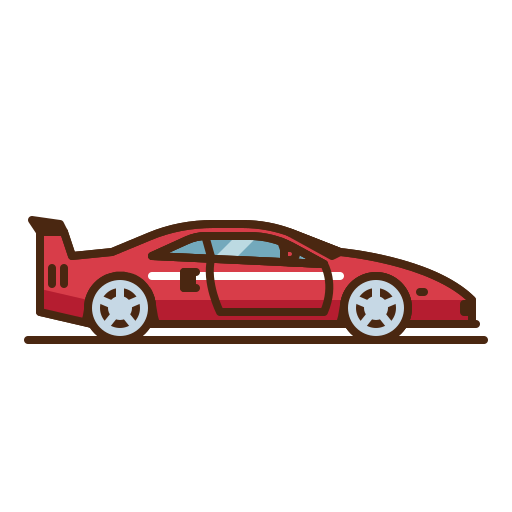

# CarSpotter

> CarSpotter was entirely vibe-coded, except for the core architecture and the ideas behind the app.

  

  <strong>The ultimate app for car spotting enthusiasts.</strong> 
  Capture and catalog the cars you spot on the road, and discover how rare they are. 100% offline and local-first.

  
  
  
  
  

---

## 📖 Overview

**CarSpotter** turns your passion for cars into an interactive, gamified collecting experience inspired by the idea of an automotive Pokédex.

When you come across a supercar, a rally legend, a vintage classic, or a rare road car, take a photo, save its exact GPS location, and instantly see its **rarity tier**. A dedicated algorithm calculates the tier using real-world data on production numbers, power, price, and historical significance.

The fast, resilient **local-first** architecture keeps all your data and photos **on your device** for privacy.

---

## 📲 Download and Update

CarSpotter isn't on Google Play yet. Install it directly using the **APK** attached to each release.

### First installation

1. Go to the **[Releases](../../releases)** section of this repository.
2. Download the `.apk` file from the *Assets* section of the latest release.
3. Open it on your phone from the download notification or the *Files* app.
4. If prompted, allow your browser or file manager to **install apps from unknown sources**.
5. Confirm the installation and open CarSpotter. 🚗

### ⚠️ Android installation warning

Android or Play Protect may flag the APK as unverified or potentially harmful during installation. This warning can appear for apps distributed outside Google Play. Publishing on Google Play requires paid registration and a review, which are outside the plans for this personal project.

The source code is public in this repository, so you can review what the app does. If you see the warning, choose **Install anyway** or **More details** followed by **Install anyway**.

### 🔄 Update the app

1. Check **[Releases](../../releases)** for a newer version than the one you have installed.
2. Download the new `.apk`.
3. Install it **over your existing version** to keep your sightings and photos.

> 💡 Before updating, use the app's export feature to create a **backup** of your data.

---

## 🔃 Keep Your Catalog Up to Date

New makes and models are added to the catalog over time. **Check for catalog updates from time to time**, especially after a new release, so you can log sightings of the latest additions.

1. Open CarSpotter and go to **Settings**.
2. Find the **Update Catalog** section.
3. Tap the update button and wait for confirmation.

> 💡 The update adds new models to the catalog and preserves your saved sightings.

---

## ✨ Key Features

### 📸 Detailed Sightings

- **Capture or import.** Take a photo with the built-in camera or select one from your gallery.
- **Record details.** Add a color, estimated production year, and personal notes. Mark race cars as 🏁 *Racing* or save special cars to *Favorites*.
- **GPS location.** Capture the sighting's coordinates and view it on an interactive map powered by [flutter_map](https://pub.dev/packages/flutter_map) and OpenStreetMap.

### 🏆 Dynamic Rarity and Icon Status

A weighted algorithm evaluates the vehicle's specifications and assigns one of five rarity tiers.

- ⚪ **Common** (mass-produced cars)
- 🟢 **Uncommon** (affordable sports cars and special variants)
- 🔵 **Rare** (prestige cars and low-production models)
- 🟣 **Epic** (supercars and limited editions)
- 🟡 **Legendary** (hypercars and ultra-exclusive editions)

The 🔥 **Icon** badge is reserved for models that left a mark on pop culture, motorsport history, or automotive design.

### 📚 Preloaded Catalog (45+ Makes, 1,000+ Models)

- Explore an offline database of **over 1,000 models from 46 makes**, including Ferrari, Porsche, Lamborghini, Alfa Romeo, Lancia, BMW, and Toyota.
- Track your completion percentage for each make.
- Search by make or model and see at a glance which cars you've already spotted.

### 🏎️ Your Personal Garage

- Browse your sightings in a photo gallery.
- **Filter and sort.** Filter by make, icon status (🔥), or racing status (🏁), or sort by rarity in either direction.
- Open a sighting to view its map and statistics or edit its details.

### 📊 Dashboard and Statistics

- See live counts for total sightings, unique models, legendary cars, and icons.
- Browse your favorite sightings in an automatic carousel with a responsive layout.
- See rotating backgrounds and visuals inspired by vintage cars and motorsport.

### 💾 100% Offline Backup and Restore

- Export your entire collection, including the SQLite/Isar database and full-resolution photos, as a single compressed `.zip` archive.
- Save it directly to your Downloads folder or share it through personal cloud storage, email, or external storage.

---

## 🛠️ Technology Stack

| Component | Technology | Description |
|---|---|---|
| **Framework** | [Flutter](https://flutter.dev/) (SDK ^3.12) | Cross-platform mobile development |
| **Language** | [Dart](https://dart.dev/) | Strongly typed, high-performance language |
| **Local Database** | [Isar Community](https://isar.dev/) | Fast local NoSQL database with relationship support |
| **Maps and GPS** | [flutter_map](https://pub.dev/packages/flutter_map) + [geolocator](https://pub.dev/packages/geolocator) | Offline-ready OpenStreetMap maps and precise geolocation |
| **Storage** | [archive](https://pub.dev/packages/archive) + [path_provider](https://pub.dev/packages/path_provider) | File system access, ZIP compression, and backups |
| **UI and Design** | Material Design 3 | Vintage and modern palette with emerald green and slate accents |

---

## ⚖️ License and Notes

### Trademarks and affiliation

CarSpotter is a **personal, non-commercial project** built for learning and out of a passion for cars. It has no affiliation, sponsorship, or endorsement from the automakers mentioned. Trademarks, logos, and vehicle names belong to their respective owners and manufacturers and are used solely for identification.

### Catalog data

The app bundles the catalog and globe logos as WebP files. [VehicleSpecs](https://github.com/vehiclespecs/brand-logos/tree/3f0929e70e0a9a2a502063edc4b3e5c0146cba74), [Cupra](https://github.com/filippofilip95/car-logos-dataset/blob/e334a4d2e8742108ba164c629dff5636576d3808/logos/optimized/cupra.png), [Dallara](https://www.dallara.it/), [Formula 1](https://www.formula1.com/).

Catalog values for power, price, production, rarity, icon status, and prestige are **estimates for reference only**. Some are subjective and may contain inaccuracies. They should not be treated as official figures or vehicle valuations.

### Privacy and personal data

Photos, GPS locations, and notes stay **on your device**. The app does not send them to any server. You are responsible for the backups you export and where you share them.

Respect other people's privacy when photographing vehicles. Avoid publishing photos with **readable license plates or recognizable people** without consent.

### Maps

The sightings map on the Home screen uses a bundled world basemap with coastlines, borders, lakes, settlements, and major roads. It places pins using the coordinates of sightings saved on your device. [Natural Earth map data](https://www.naturalearthdata.com/about/terms-of-use/)

Italian municipality, town, and hamlet names come from the Italian GeoNames extract and appear at different zoom levels. [© GeoNames](https://www.geonames.org/export/), [CC BY 4.0](https://creativecommons.org/licenses/by/4.0/)

Open the offline **Sighting Origins** globe from the **Your Spots** card. The globe highlights countries of origin for the makes you've spotted. Tap a country to see its makes and open the Garage with the corresponding filter applied. [Natural Earth country boundaries](https://www.naturalearthdata.com/downloads/50m-cultural-vectors/)

The maps used to add and view sightings use data licensed under the ODbL. [© OpenStreetMap contributors](https://www.openstreetmap.org/copyright)

### Third-party libraries

The app uses open-source packages, including Flutter, Isar, flutter_map, geolocator, and archive. Each package is subject to its own license. See `pubspec.yaml` for the full list.

### Disclaimer of warranty

The software is provided **"as is," without warranty** of any kind. The author is not liable for any damage or data loss arising from use of the app. Install the APK at your own risk and always back up your data before updating.

---
